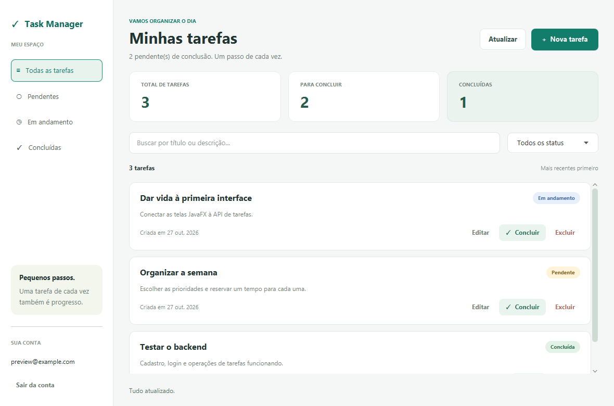

# Task Manager Desktop

Aplicativo JavaFX separado do backend `task-manager-api`, usando Java 21, Maven, FXML e CSS.

## Como executar no IntelliJ

1. Abra esta pasta como um **novo projeto** (File → Open → New Window).
2. Aguarde o IntelliJ importar o `pom.xml`.
3. Em Project SDK, selecione JDK 21.
4. Deixe a API Spring Boot rodando em `http://localhost:8080`.
5. No painel Maven, execute **Plugins → javafx → javafx:run**.
   Outra opção é executar a classe `Launcher` com o classpath Maven.

Pelo terminal, com JDK 21 e Maven:
```text
mvn clean test
mvn javafx:run
```

O wrapper incluído permite usar `mvnw.cmd` no Windows e `./mvnw` no Linux/macOS.
A variável `JAVA_HOME` deve apontar para seu JDK 21.

## Onde está cada responsabilidade

- `TaskManagerApp`: inicia a janela, troca as telas e mantém o cliente da API.
- `controller/AuthController`: cadastro, login, validação e mensagens do formulário.
- `controller/DashboardController`: tarefas, filtros, busca e formulário de edição.
- `api/ApiClient`: requisições assíncronas, JSON, JWT e tradução de erros.
- `model/`: records e enum com os dados trocados com a API.
- `src/main/resources/com/portfolio/taskmanager/desktop/`: telas FXML e aparência CSS.
- `src/test/`: contrato HTTP, carregamento das telas e integração opcional com o backend.

## Fluxo da aplicação

Cadastro → login → painel de tarefas. O token JWT permanece somente em memória.
Fechar o aplicativo ou sair da conta exige um novo login.
O cliente usa `POST/GET /api/tasks`, e o servidor identifica o dono pelo token.
Busca e filtros atuam sobre a lista carregada; o botão Atualizar busca mudanças feitas em outros clientes.

O `HttpClient.sendAsync` executa a comunicação fora da thread gráfica.
`Platform.runLater` aplica o resultado na interface. Ações em andamento ficam desabilitadas.
Ao receber HTTP 401 no painel, o aplicativo volta ao login.

## Configuração da API

Use a variável de ambiente `TASK_API_URL` (padrão: `http://localhost:8080`).
Também é possível usar a opção da JVM `-Dtask.api.url=http://localhost:8080`.
Para servidores fora do computador local, use HTTPS.

## Testes

`mvn test` executa os testes locais com servidor HTTP simulado e carrega os FXML
com o toolkit JavaFX. O teste de FXML precisa de uma sessão gráfica disponível.

Com o backend e PostgreSQL ativos:
```text
mvn -Dtask.integration=true test
```
O teste de integração cria uma conta de teste com e-mail aleatório, executa o CRUD e
remove a tarefa em um bloco finally. A conta permanece no banco, pois a API não
oferece exclusão de usuários. Nenhum usuário existente é alterado.

## Escopo desta primeira versão

Login, cadastro, listagem, busca, filtros, criação, edição, conclusão, reabertura,
exclusão confirmada, contadores e tratamento de indisponibilidade/expiração.
Ainda não inclui instalador Windows, recuperação de senha, uso offline ou notificações.

## Preview



A imagem usa dados sintéticos do teste visual; não contém contas reais.

## Regras de entrada

Cadastro: senha com pelo menos 8 caracteres e até 72 bytes UTF-8.
Título de tarefa: até 255 caracteres. Descrição: até 2000 caracteres.
A interface antecipa essas validações; o backend também as aplica.

## Backend e estudo do projeto

O backend fica no projeto separado task-manager-api:
https://github.com/Jaumbitin/task-manager-api

Veja [arquitetura e ordem de leitura](docs/ARCHITECTURE.md)
e [roteiro de testes](docs/TESTING.md).

## Git e integração contínua

Fontes, FXML, CSS, wrapper, documentação e testes são versionados.
target/, work/, .idea/ e arquivos privados ficam fora do Git.
A pipeline compila e testa com Java 21 e Xvfb no Linux.
O teste contra a API real é opt-in e não roda na pipeline do desktop.

Esta versão é um aplicativo de desenvolvimento/portfólio.
Para distribuição, ainda é necessário empacotar um runtime/instalador
e configurar HTTPS no backend remoto.
