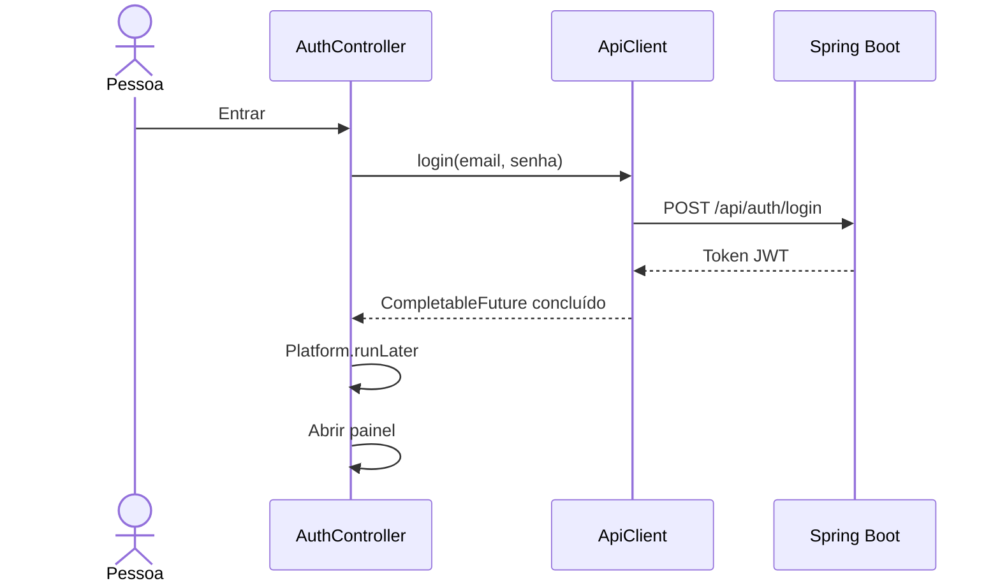

# Como acompanhar o código

Leia nesta ordem:

1. `Launcher`: ponto de entrada, com método main.
2. `TaskManagerApp`: cria a janela, carrega FXML e troca login/painel.
3. `auth.fxml`: estrutura dos campos e botões.
4. `AuthController`: valida campos e decide o que fazer ao clicar.
5. `ApiClient`: envia HTTP e converte JSON usando Jackson.
6. `dashboard.fxml` e `DashboardController`: busca, filtros e operações de tarefas.
7. `styles.css`: cores, tipografia e espaçamento.

As requisições usam sendAsync. Atualizações dos controles acontecem na thread
JavaFX, por Platform.runLater. As ações ficam indisponíveis durante o envio.
O formulário de tarefa permanece aberto e conserva o texto se ocorrer erro.

O token é guardado em memória; sair ou fechar o app limpa a sessão local.
HTTP 401 no painel leva ao login. Nenhuma senha/token é gravado em arquivo.

O cliente usa as rotas sem userId. A API é responsável pelo controle de acesso.
Contadores, busca e filtros usam as tarefas já carregadas. Atualizar refaz a consulta.
